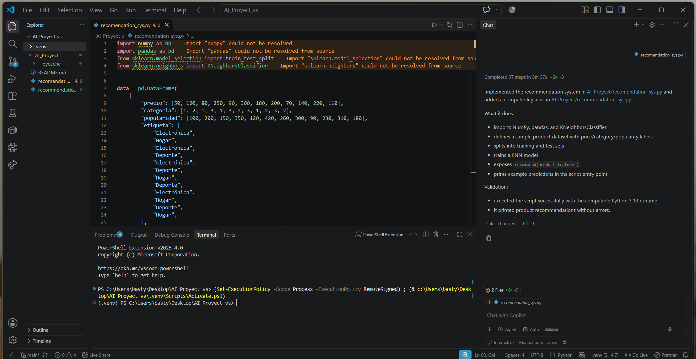
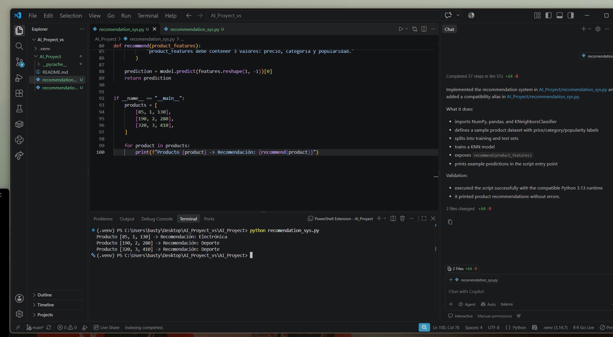

# AI_Proyect
# Sistema de Recomendación con GitHub Copilot

Proyecto formativo para la asignatura **Tendencias de la Inteligencia Artificial Aplicada**, donde se implementa un modelo de recomendación de productos utilizando Machine Learning y la asistencia de **GitHub Copilot**.

## 1. Definición del Prompt y Requisitos
Se ingresaron las instrucciones estructuradas en comentarios para guiar a GitHub Copilot en la creación del modelo:

## 2. Generación del Código Asistida por IA
GitHub Copilot generó el script en Python estructurando los datos, el preprocesamiento y el entrenamiento del clasificador:

## 3. Ejecución y Validación del Modelo
Se ejecutó el script `recomendation_sys.py` en la terminal de Visual Studio Code, validando las predicciones del recomendador:

